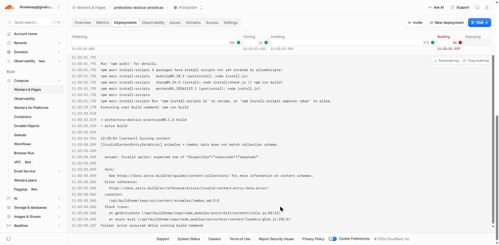

# Resultado contra los criterios de aceptación

> **Proyecto de prácticas.** No es la web oficial de Amics dels Animals Dosrius.

Medición de la web contra [CRITERIOS.md](CRITERIOS.md). Cada criterio se marca como **cumple**, **cumple en parte** o **no realizada**, junto con la prueba que lo demuestra. En la tabla de resumen, las pruebas no realizadas cuentan en la columna «No cumple».

Última actualización: 23/11/2026.

## Resumen

| Bloque | Cumple | En parte | No cumple | Pendiente |
| --- | --- | --- | --- | --- |
| Contenido (C1–C4) | 4 | 0 | 0 | 0 |
| Proyecto de prácticas (P1–P4) | 4 | 0 | 0 | 0 |
| Edición (E1–E7) | 5 | 2 | 0 | 0 |
| Calidad (Q1–Q5) | 4 | 0 | 1 | 0 |
| Hosting y coste (H1–H2) | 1 | 1 | 0 | 0 |
| Entregables (D1–D5) | 4 | 0 | 1 | 0 |

## Contenido

| # | Resultado | Prueba |
| --- | --- | --- |
| C1 | **Cumple** | El menú tiene Animales, Cómo adoptar, Colaborar, Noticias, Quiénes somos y Contacto. Además están la portada y la ficha de cada animal. Todo el contenido está en castellano. |
| C2 | **Cumple** | El esquema de `src/content.config.ts` obliga a rellenar todos los campos y pide al menos una foto con su descripción. Revisadas las fichas de Luna, Pelut y Tambor. |
| C3 | **Cumple** | Probado en Chrome: el filtro «Gato» muestra «Mostrando 2 de 6 animales» y guarda `?especie=gato` en la URL. Al pasar a Pelut a «Adoptado» desde el CMS, dejó de salir entre los disponibles y apareció en «Ya tienen casa». |
| C4 | **Cumple** | 8 animales (6 buscan casa y 2 adoptados) y 4 noticias o eventos. |

## Proyecto de prácticas

| # | Resultado | Prueba |
| --- | --- | --- |
| P1 | **Cumple** | El aviso sale arriba en todas las páginas y se repite en el pie, con un enlace a la página pública de la entidad en Teaming. |
| P2 | **Cumple** | `npm run verify -- <url>` recorre las 20 URL del sitemap y una URL inexistente: todas llevan `meta robots` con `noindex` y la cabecera `X-Robots-Tag: noindex, nofollow`. |
| P3 | **Cumple** | Animales inventados. No hay nombres ni teléfonos de voluntarios, y el correo es `hola@ejemplo.org`. Las 9 fotos son de Wikimedia Commons, con licencia libre y la autoría anotada en el README. Rufo usa una ilustración propia. |
| P4 | **Cumple** | No hemos contactado con la entidad. Los datos reales salen de su página pública de Teaming, que está citada en el README. |

## Edición

| # | Resultado | Prueba |
| --- | --- | --- |
| E1 | **Cumple** | Invitamos por Pages CMS a un correo sin cuenta de GitHub. Desde el móvil se entró con ese correo y el código que llegó por email, y se vio la lista de animales. |
| E2 | **Cumple en parte** | Con la cuenta de voluntario, desde el móvil: se dio de alta a Blanquito con foto y luego se cambió su estado a «Reservado». No probamos con la cuenta de voluntario publicar una noticia ni editar una página fija. Usan el mismo formulario y el mismo guardado que las fichas, así que deberían funcionar igual (**estimado**). Observado: después de guardar, el editor se queda en la misma ficha, y la voluntaria cambió el estado de Blanquito creyendo que estaba en la de Tambor. Va a la guía. |
| E3 | **Cumple** | Medido tres veces: un push tardó 49 s en publicarse (09:31:13 → 09:32:02); un cambio de estado desde Pages CMS, 69 s (09:44:32 → 09:45:41); y el alta de Blanquito desde el móvil, 50 s (10:23:38 → 10:24:28). Las tres están muy por debajo de 5 minutos. La construcción se reparte así: preparar el entorno 38 s, clonar 2 s, instalar dependencias 37 s y construir unos 5 s. |
| E4 | **Cumple en parte** | **Una foto de móvil sin tocar no se puede subir:** Pages CMS devuelve un error 413 con las fotos de más de unos 3 MB. Es un límite de su versión alojada en Vercel (issue #393, abierta). Lo que sí funciona: las fotos que caben (las de Commons, de unos 700 KB) se sirven en WebP a 320, 480 y 640 px, y el texto alternativo es obligatorio. El apaño para voluntarios es reducir la foto antes, por ejemplo enviándola por WhatsApp. Probado desde el móvil: la foto, enviada antes por WhatsApp, quedó en 240 KB (1536 × 2048 px), sin metadatos EXIF y por tanto sin GPS. Subió sin error y la web la sirve en tres tamaños. |
| E5 | **Cumple** | Con la cuenta de voluntario, el menú no muestra «Configuration» ni «Collaborators». Según la documentación, esas rutas exigen una identidad de GitHub; no probamos a abrirlas escribiendo la dirección a mano. Los commits del voluntario salen a nombre de `pages-cms[bot]`, sin su correo. |
| E6 | **Cumple** | Probado: borramos la ficha de Blanquito con un commit, igual que hace el CMS al borrar (commit `c3e4f67`, 10:34:10). A las 10:35:17 la web daba 404. La recuperamos desde el historial con `git revert` (10:35:29) y a las 10:36:47 volvía a estar en la web con su foto y su estado. El historial de Git no caduca, así que vale igual un mes después. Recuperar lo tiene que hacer alguien con acceso a GitHub: el CMS no tiene botón para deshacer un borrado. |
| E7 | **Cumple** | Subimos a propósito un estado inválido (`perdido`). La construcción falló con `InvalidContentEntryDataError ... estado: Invalid option: expected one of "disponible"\|"reservado"\|"adoptado"` y la web siguió mostrando a Tambor como «Disponible». Después lo revertimos.  |

## Calidad

| # | Resultado | Prueba |
| --- | --- | --- |
| Q1 | **Cumple** | `npm run calidad`: Lighthouse móvil da 100 en Accesibilidad en las 5 plantillas, sin auditorías fallidas. Lighthouse usa axe-core. Informes en `calidad/`. |
| Q2 | **Cumple** | Recorrido con teclado en Chrome: el primer Tab muestra «Saltar al contenido», que lleva el foco a `#contenido`. El foco se ve en todos los enlaces y controles. Los filtros del listado se usan con las flechas y el recuento se actualiza («Mostrando 2 de 6 animales»). `scripts/contraste-teclado.mjs`: los 14 pares de colores cumplen AA, entre 5,44:1 y 15,14:1. A 375 px, el botón «Menú» se alcanza con Tab, se abre con Enter y se cierra con Escape, y el foco vuelve al botón. Todas las páginas declaran `lang="es"`. Arreglado: el contorno de foco de «Saltar al contenido» casi no se veía sobre la barra oscura del aviso. |
| Q3 | **No realizada** | No hicimos la prueba con NVDA. Lo que sí está comprobado: títulos en orden, textos alternativos en todas las fotos, recuento de los filtros anunciado con `role="status"` y 100 en Accesibilidad en Lighthouse. |
| Q4 | **Cumple** | Lighthouse móvil, con las fotos reales: 100 en Rendimiento en el inicio, el listado y la ficha. LCP entre 0,8 s y 1,8 s. |
| Q5 | **Cumple** | Sin scroll horizontal en las 5 plantillas a 320, 375, 768 y 1440 px. Capturas en `calidad/capturas/`. |

## Hosting y coste

| # | Resultado | Prueba |
| --- | --- | --- |
| H1 | **Cumple en parte** | Coste: 0 €. Los límites están en [COMPARATIVA.md](COMPARATIVA.md). Medido: cada construcción gasta unos 1,4 minutos del cupo de 3.000 al mes, así que caben unas 2.100 construcciones al mes. Falta revisar si Cloudflare pidió un método de pago. |
| H2 | **Cumple** | HTTPS en `*.workers.dev`. Repositorio público sin secretos. Los commits usan la dirección `noreply` de GitHub. |

## Entregables

| # | Resultado | Prueba |
| --- | --- | --- |
| D1 | **Cumple** | [COMPARATIVA.md](COMPARATIVA.md), apartado de CMS. |
| D2 | **Cumple** | [COMPARATIVA.md](COMPARATIVA.md), apartado de hosting. |
| D3 | **Cumple** | [GUIA-EDITOR.md](GUIA-EDITOR.md). Pendiente de corregirla según lo que salga de la prueba D4. |
| D4 | **No realizada** | No hicimos la prueba con una persona ajena al proyecto. La guía sí recoge lo que observamos en la prueba con la cuenta de voluntario: el límite de las fotos y el despiste de cambiar un animal que no era. |
| D5 | **Cumple** | [APRENDIZAJE.md](APRENDIZAJE.md), separado en medido, observado y estimado. |

## Cosas que hemos aprendido por el camino

- **Pages CMS firma con tu cuenta si entras con GitHub.** Aunque `.pages.yml` diga `commit.identity: app`, el commit que hicimos con la sesión de GitHub del administrador salió con su nombre y su correo personal. Como el repositorio es público, el correo quedó visible. Lo corregimos reescribiendo ese commit. Para que no vuelva a pasar, hay que activar en GitHub la opción de mantener el correo privado (pendiente de comprobar que funciona con Pages CMS). Las personas invitadas por email no tienen este problema: según la documentación, sus commits salen con la identidad de la aplicación.
- **Pages CMS reescribe los archivos al guardar.** Cambia el orden de los campos, pasa las listas al formato de varias líneas y quita las comillas que no hacen falta. No afecta a la web, pero el primer commit de cada ficha cambia más líneas de las que se han editado.
- **El límite de tamaño de las fotos no estaba en la documentación.** Pages CMS no documenta cuánto puede pesar un archivo. Lo descubrimos al subir la primera foto de móvil (error 413) y buscando en sus issues. Lección: antes de elegir, probar el caso más típico del usuario real (aquí, una foto de móvil), no solo leer la documentación.
- **Las fotos de móvil llevan la ubicación GPS.** Astro la quita de las imágenes que publica, pero el original se queda en el repositorio público. La guía pide desactivar la ubicación de la cámara o pasar la foto por WhatsApp, que la borra.
- **Astro acepta rutas de imagen absolutas desde la raíz** (`/src/assets/animales/luna.jpg`). Pages CMS no documenta si admite rutas relativas, pero con ese formato encajan los dos.
